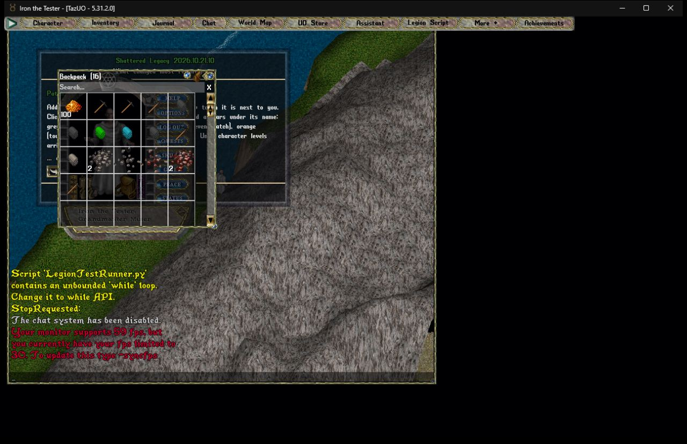
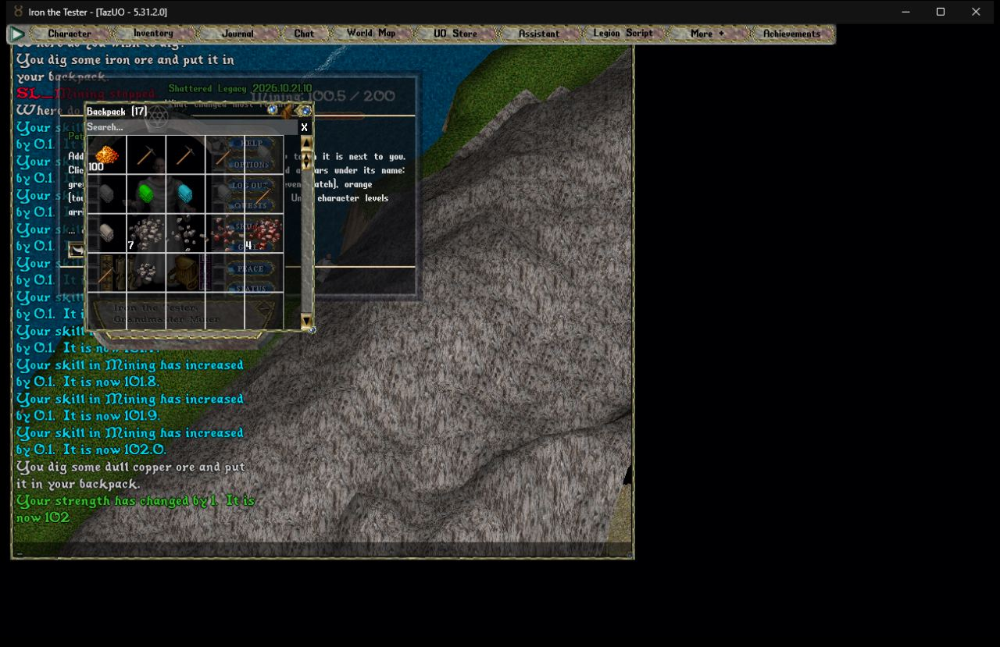

# Legion script test: SL_Mining.py (Iron, 2026-10-21 11:35)

**Result: PASS**: every step passed.

- Script: `D:\UO\sl-scripts\SL_Mining.py`
- Plan: `D:\UO\golems\Iron\ShatteredLegacy\tools\legion-test\plans\SL_Mining.json` (time limit 6 min)
- Shard: this PC's test shard, 127.0.0.1:2594 (the never-live guard passed; relay redirects ignored)
- Account: `iron-player`, character Iron the Tester; setup by `iron-admin`
- Ran: 11:35:08 to 11:36:17 (69 s, the client start included)
- Test overrides in the script's CONFIG: `GUI = False`, `WANDER = False`, `AUTO_SMELT = False`, `LOOP_FOREVER = False`

## Steps

| Step | Result | Detail |
|---|---|---|
| stands at the Minoc mine spot | pass | at 2553, 479 (wanted 2553, 479 within 2) |
| mines five times | pass | 5 of 5 journal lines |
| ore in the backpack | pass | 1 more in the backpack (wanted 1) |

## Setup (the Golem's Admin, on the test shard)

- `[global set Skills.Mining.Base 100 Str 100 where playermobile Name == "Iron the Tester"`: Property has been set. (2)
- `[global addtopack Pickaxe where playermobile Name == "Iron the Tester"`: 1 object generated in 0.00 seconds.
- `[global set LogoutMap Trammel LogoutLocation "(2553, 479, 8)" where playermobile Name == "Iron the Tester"`: Property has been set. (2)

## Screenshots






## Journal (the client, last lines)

```
10/21/2026 11:35:30 System: Script 'SL_Mining.py' contains an unbounded 'while' loop. Change it to while API.StopRequested:
10/21/2026 11:35:31 System: System: Not here. Open it in a guarded town, or in a house where you are an owner, co-owner or friend.
10/21/2026 11:35:32 System: You must wait to perform another action.
10/21/2026 11:35:32 System: System: Not here. Open it in a guarded town, or in a house where you are an owner, co-owner or friend.
10/21/2026 11:35:33 System: You must wait to perform another action.
10/21/2026 11:35:33 System: System: Not here. Open it in a guarded town, or in a house where you are an owner, co-owner or friend.
10/21/2026 11:35:34 System: You must wait to perform another action.
10/21/2026 11:35:35 System: [Mining] Opened 6 bag(s) in the pack to look for tools
10/21/2026 11:35:35 System: [Mining] Using pickaxe. Radius 2, smelt at 75%.
10/21/2026 11:35:35 You see: Dull Copper vein
10/21/2026 11:35:35 System: Where do you wish to dig?
10/21/2026 11:35:35 System: Target cannot be seen.
10/21/2026 11:35:35 You see: Tile 1/25
10/21/2026 11:35:35 System: You must wait to perform another action.
10/21/2026 11:35:40 System: Where do you wish to dig?
10/21/2026 11:35:40 System: Target cannot be seen.
10/21/2026 11:35:40 You see: Tile 2/25
10/21/2026 11:35:40 System: You must wait to perform another action.
10/21/2026 11:35:44 System: Where do you wish to dig?
10/21/2026 11:35:44 System: Target cannot be seen.
10/21/2026 11:35:45 You see: Tile 3/25
10/21/2026 11:35:45 System: You must wait to perform another action.
10/21/2026 11:35:49 System: Where do you wish to dig?
10/21/2026 11:35:49 System: Target cannot be seen.
10/21/2026 11:35:50 You see: Tile 4/25
10/21/2026 11:35:50 System: You must wait to perform another action.
10/21/2026 11:35:54 System: Where do you wish to dig?
10/21/2026 11:35:55 System: You dig some dull copper ore and put it in your backpack.
10/21/2026 11:35:55 System: Your strength has changed by 1.  It is now 101
10/21/2026 11:35:55 System: Where do you wish to dig?
10/21/2026 11:35:56 System: You dig some iron ore and put it in your backpack.
10/21/2026 11:35:57 System: Where do you wish to dig?
10/21/2026 11:35:57 System: You dig some dull copper ore and put it in your backpack.
10/21/2026 11:35:58 System: Where do you wish to dig?
10/21/2026 11:35:59 System: You dig some dull copper ore and put it in your backpack.
10/21/2026 11:35:59 System: Where do you wish to dig?
10/21/2026 11:36:00 System: You dig some dull copper ore and put it in your backpack.
10/21/2026 11:36:00 System: Your dexterity has changed by 1.  It is now 52
10/21/2026 11:36:00 System: Where do you wish to dig?
(10 skill-gain lines left out)
```

## Legion log (the script's own log, this run)

```
2026-10-21 11:11:41 [1 2553,479] ===== SL_Mining started =====
2026-10-21 11:11:42 [1 2553,479] state: Reading logbook
2026-10-21 11:11:45 [1 2553,479] [Mining] Opened 5 bag(s) in the pack to look for tools
2026-10-21 11:11:45 [1 2553,479] [Mining] Using pickaxe. Radius 2, smelt at 75%.
2026-10-21 11:11:45 [1 2553,479] state: Mining
2026-10-21 11:11:49 [1 2553,479] swing 2553,478 (land) -> retry
2026-10-21 11:11:51 [1 2553,479] [Mining] New Dull Copper vein logged! Report it to the Survey Archivist.
2026-10-21 11:11:51 [1 2553,479] swing 2553,478 (land) -> ore
2026-10-21 11:11:52 [1 2553,479] swing 2553,478 (land) -> ore
2026-10-21 11:11:53 [1 2553,479] swing 2553,478 (land) -> ore
2026-10-21 11:11:54 [1 2553,479] swing 2553,478 (land) -> ore
2026-10-21 11:11:55 [1 2553,479] swing 2553,478 (land) -> ore
2026-10-21 11:11:57 [1 2553,479] swing 2553,478 (land) -> ore
2026-10-21 11:11:57 [1 2553,479] SL_Mining stopped.
2026-10-21 11:11:57 [0 0,479] stopped (the client cancelled the script)
2026-10-21 11:35:31 [1 2553,479] ===== SL_Mining started =====
2026-10-21 11:35:31 [1 2553,479] state: Reading logbook
2026-10-21 11:35:35 [1 2553,479] [Mining] Opened 6 bag(s) in the pack to look for tools
2026-10-21 11:35:35 [1 2553,479] [Mining] Using pickaxe. Radius 2, smelt at 75%.
2026-10-21 11:35:35 [1 2553,479] state: Mining
2026-10-21 11:35:35 [1 2553,479] swing 2554,480 (land) -> bad  heard: Target cannot be seen
2026-10-21 11:35:40 [1 2553,479] swing 2554,481 (land) -> retry
2026-10-21 11:35:40 [1 2553,479] swing 2554,481 (land) -> bad  heard: Target cannot be seen
2026-10-21 11:35:44 [1 2553,479] swing 2555,480 (land) -> retry
2026-10-21 11:35:45 [1 2553,479] swing 2555,480 (land) -> bad  heard: Target cannot be seen
2026-10-21 11:35:49 [1 2553,479] swing 2555,481 (land) -> retry
2026-10-21 11:35:50 [1 2553,479] swing 2555,481 (land) -> bad  heard: Target cannot be seen
2026-10-21 11:35:54 [1 2553,479] swing 2553,478 (land) -> retry
2026-10-21 11:35:55 [1 2553,479] swing 2553,478 (land) -> ore
2026-10-21 11:35:57 [1 2553,479] swing 2553,478 (land) -> ore
2026-10-21 11:35:58 [1 2553,479] swing 2553,478 (land) -> ore
2026-10-21 11:35:59 [1 2553,479] swing 2553,478 (land) -> ore
2026-10-21 11:36:00 [1 2553,479] swing 2553,478 (land) -> ore
2026-10-21 11:36:01 [1 2553,479] swing 2553,478 (land) -> ore
2026-10-21 11:36:01 [1 2553,479] SL_Mining stopped.
2026-10-21 11:36:01 [0 0,479] stopped (the client cancelled the script)
```

## Runner log

```
2026-10-21 11:35:25 in the world as Iron the Tester; waiting for go
2026-10-21 11:35:30 started SL_Mining.py
2026-10-21 11:36:00 done: pass (every step passed)
```

## Client errors

None.

## Server errors (the test shard's log, this run)

None.
